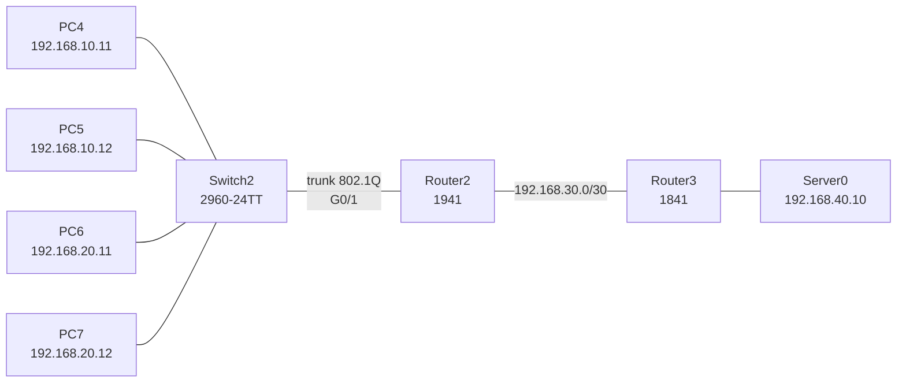

# 🧱 VLAN et routage inter-VLAN

Segmentation d'un réseau en deux **VLAN** sur un commutateur **Cisco 2960**, routage entre ces VLAN par la méthode **router-on-a-stick**, puis accès à un serveur situé derrière un second routeur grâce à des **routes statiques**. Réalisé sous **Cisco Packet Tracer**, avec un dépannage complet couche par couche.

[⬅ Retour au portfolio](https://github.com/EvanBienvenu/EvanBienvenu)

## Contexte

Quatre postes sont branchés sur le même commutateur mais doivent être séparés en deux groupes, pour des raisons de sécurité et d'organisation. Ils doivent malgré tout pouvoir communiquer entre eux de façon contrôlée et accéder à un serveur central.

## Objectifs

- Créer deux VLAN et y répartir les postes
- Faire transiter les deux VLAN sur un seul câble (trunk 802.1Q)
- Router entre les VLAN avec des sous-interfaces
- Relier deux routeurs par un lien en /30 et configurer les routes statiques
- **Résultat attendu :** chaque PC joint le serveur `192.168.40.10` et les PC de l'autre VLAN

## Topologie



| VLAN | Nom | Postes | Réseau |
| --- | --- | --- | --- |
| 10 | PC4_PC5 | PC4, PC5 | 192.168.10.0/24 |
| 20 | PC6_PC7 | PC6, PC7 | 192.168.20.0/24 |

### Plan d'adressage

| Équipement | Interface | Adresse IP | Masque | Passerelle |
| --- | --- | --- | --- | --- |
| PC4 | Fa0 | 192.168.10.11 | 255.255.255.0 | 192.168.10.1 |
| PC5 | Fa0 | 192.168.10.12 | 255.255.255.0 | 192.168.10.1 |
| PC6 | Fa0 | 192.168.20.11 | 255.255.255.0 | 192.168.20.1 |
| PC7 | Fa0 | 192.168.20.12 | 255.255.255.0 | 192.168.20.1 |
| Router2 | G0/1.10 (VLAN 10) | 192.168.10.1 | 255.255.255.0 | |
| Router2 | G0/1.20 (VLAN 20) | 192.168.20.1 | 255.255.255.0 | |
| Router2 | G0/0 (vers Router3) | 192.168.30.1 | 255.255.255.252 | |
| Router3 | Fa0/0 (vers Router2) | 192.168.30.2 | 255.255.255.252 | |
| Router3 | Fa0/1 (vers serveur) | 192.168.40.1 | 255.255.255.0 | |
| Server0 | Fa0 | 192.168.40.10 | 255.255.255.0 | 192.168.40.1 |

Le lien entre les deux routeurs est en **/30** : il ne relie que deux équipements, donc deux adresses suffisent.

## Configuration

### Switch2

```cisco
vlan 10
 name PC4_PC5
vlan 20
 name PC6_PC7
!
interface range fa0/1-2
 switchport mode access
 switchport access vlan 10
interface range fa0/3-4
 switchport mode access
 switchport access vlan 20
!
interface g0/1
 switchport mode trunk
 switchport trunk allowed vlan 10,20
end
write memory
```

### Router2 : router-on-a-stick et route vers le serveur

```cisco
interface g0/1
 no shutdown
interface g0/1.10
 encapsulation dot1Q 10
 ip address 192.168.10.1 255.255.255.0
interface g0/1.20
 encapsulation dot1Q 20
 ip address 192.168.20.1 255.255.255.0
interface g0/0
 ip address 192.168.30.1 255.255.255.252
 no shutdown
!
ip route 192.168.40.0 255.255.255.0 192.168.30.2
```

### Router3 : routes de retour vers les VLAN

```cisco
interface fa0/0
 ip address 192.168.30.2 255.255.255.252
 no shutdown
interface fa0/1
 ip address 192.168.40.1 255.255.255.0
 no shutdown
!
ip route 192.168.10.0 255.255.255.0 192.168.30.1
ip route 192.168.20.0 255.255.255.0 192.168.30.1
```

Sans ces deux routes, Router3 recevrait bien les pings des PC, mais ne saurait pas où renvoyer la réponse.

## Tests

Tests de proche en proche depuis PC4, pour localiser précisément une éventuelle panne :

| Test | Ce qu'il valide | Résultat |
| --- | --- | --- |
| `ping 192.168.10.1` | Passerelle du VLAN 10 | ✅ |
| `ping 192.168.30.1` puis `192.168.30.2` | Lien entre les routeurs | ✅ |
| `ping 192.168.40.1` | Interface de Router3 côté serveur | ✅ |
| `ping 192.168.40.10` | Serveur | ✅ |
| `ping 192.168.20.11` | Routage inter-VLAN | ✅ |

Commandes de vérification utilisées : `show vlan brief`, `show interfaces trunk`, `show ip interface brief`, `show ip route`.

## Problèmes rencontrés et résolus

| # | Symptôme | Diagnostic | Correction |
| --- | --- | --- | --- |
| 1 | Les PC ne joignent même pas leur passerelle | Le switch était correct (`show vlan brief`, `show interfaces trunk`). `show ip interface brief` sur Router2 a montré que les sous-interfaces avaient été créées sur **G0/0**, alors que le câble du switch était branché sur **G0/1** | Sous-interfaces recréées sur G0/1, lien vers Router3 déplacé sur G0/0 |
| 2 | Pas de ping entre Router2 et Router3, lien rouge | Interfaces correctement adressées et activées : problème de **couche 1** | Remplacement par le bon type de câble |
| 3 | Lien rouge entre Router3 et le serveur | Le réglage **Port Status** de l'interface du serveur était désactivé (spécifique à Packet Tracer) | Port Status passé à ON |
| 4 | Un seul ping perdu ponctuellement | Aucune erreur de configuration : délai de **résolution ARP** au premier envoi | Aucune : test répété avec succès |

## Ce que j'ai appris

- Dépanner **couche par couche** (physique, puis liaison, puis réseau) plutôt que modifier la configuration au hasard
- Toujours **comparer la configuration au câblage réel** : une configuration juste sur la mauvaise interface ne fonctionne pas
- Configurer les routes **dans les deux sens**
- Ne pas confondre une vraie panne avec un premier paquet perdu à cause d'ARP

## Pistes d'amélioration

- Remplacer les routes statiques par **OSPF**
- Sécuriser le trunk (VLAN natif différent de 1) et les ports d'accès (port security)
- Distribuer les adresses par **DHCP** plutôt qu'en statique
- Ajouter une **ACL** limitant l'accès au serveur à certains VLAN

## Compétences mobilisées

[VLAN et inter-VLAN](https://github.com/EvanBienvenu/competences-reseau/blob/main/03-vlan-intervlan.md) · [Routage](https://github.com/EvanBienvenu/competences-reseau/blob/main/02-routage.md) · [Bases de Cisco IOS](https://github.com/EvanBienvenu/competences-reseau/blob/main/01-bases-cisco-ios.md)

## 📖 Termes techniques

| Terme | Explication |
| --- | --- |
| **VLAN** | Réseau virtuel : découpage d'un switch en plusieurs réseaux séparés. |
| **Port access** | Port de switch qui appartient à un seul VLAN (pour brancher un PC). |
| **Trunk** | Lien qui transporte plusieurs VLAN à la fois entre deux équipements. |
| **802.1Q (dot1Q)** | Norme qui « étiquette » chaque trame avec son numéro de VLAN sur un trunk. |
| **Router-on-a-stick** | Un seul port de routeur, découpé en sous-interfaces, route tous les VLAN. |
| **Sous-interface** | Interface virtuelle créée sur un port physique (ex. `G0/1.10`). |
| **Route statique** | Chemin vers un réseau, écrit à la main par l'administrateur. |
| **/30** | Petit réseau de 2 adresses utilisables, idéal pour relier deux routeurs. |
| **Modèle OSI** | Découpage du fonctionnement d'un réseau en 7 couches, de la couche physique (câbles) aux applications. |
| **ARP** | Protocole qui trouve l'adresse physique (MAC) d'une machine à partir de son adresse IP. |

Tous les termes sont aussi expliqués dans le [glossaire du portfolio](https://github.com/EvanBienvenu/EvanBienvenu/blob/main/GLOSSAIRE.md).
