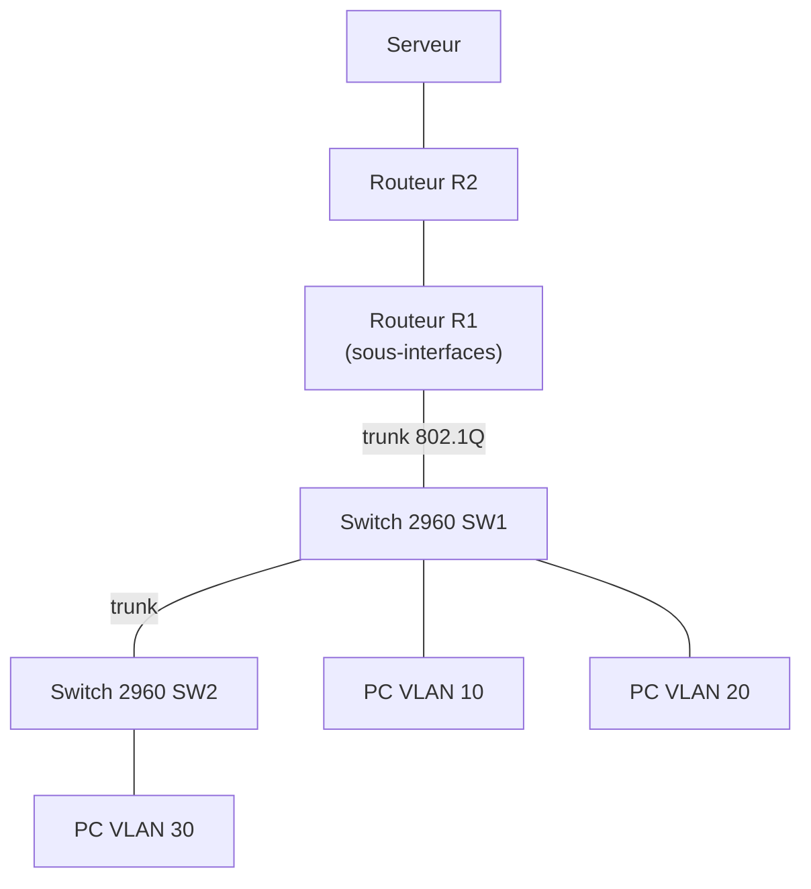

# 🧱 VLAN et routage inter-VLAN

Segmentation d'un réseau local en plusieurs **VLAN** sur des switches **Cisco 2960**, puis mise en place du **routage inter-VLAN** pour que ces réseaux puissent communiquer de façon contrôlée, jusqu'à un serveur placé derrière un second routeur.

[⬅ Retour au portfolio](https://github.com/EvanBienvenu/EvanBienvenu)

## Contexte

Dans une entreprise, tous les services ne doivent pas être sur le même réseau : séparer la comptabilité, la direction et les autres services améliore la sécurité et limite le trafic inutile. Les VLAN permettent ce découpage sans acheter un switch par service.

## Objectifs

- Créer plusieurs VLAN et y affecter les ports des switches
- Relier les switches par des liens trunk
- Permettre la communication entre VLAN via un routeur
- Atteindre un serveur situé derrière un second routeur

## Topologie



<!-- À vérifier : remplacer les numéros de VLAN et les adresses par ceux de la maquette réelle. -->

### Plan des VLAN

| VLAN | Nom | Réseau | Passerelle |
| --- | --- | --- | --- |
| 10 | Administration | 192.168.10.0/24 | 192.168.10.254 |
| 20 | Comptabilité | 192.168.20.0/24 | 192.168.20.254 |
| 30 | Direction | 192.168.30.0/24 | 192.168.30.254 |

## Configuration

### Switch : création des VLAN et des ports

```cisco
vlan 10
 name Administration
vlan 20
 name Comptabilite
vlan 30
 name Direction
!
interface FastEthernet0/1
 switchport mode access
 switchport access vlan 10
!
interface GigabitEthernet0/1
 switchport mode trunk
```

### Routeur R1 : router-on-a-stick

```cisco
interface GigabitEthernet0/0
 no shutdown
!
interface GigabitEthernet0/0.10
 encapsulation dot1Q 10
 ip address 192.168.10.254 255.255.255.0
!
interface GigabitEthernet0/0.20
 encapsulation dot1Q 20
 ip address 192.168.20.254 255.255.255.0
!
interface GigabitEthernet0/0.30
 encapsulation dot1Q 30
 ip address 192.168.30.254 255.255.255.0
```

## Tests et vérifications

| Test | Commande | Résultat attendu |
| --- | --- | --- |
| VLAN créés | `show vlan brief` | Les VLAN et leurs ports apparaissent |
| Trunk actif | `show interfaces trunk` | Les VLAN autorisés passent sur le lien |
| Sous-interfaces | `show ip interface brief` | Sous-interfaces `up` |
| Inter-VLAN | `ping` d'un PC du VLAN 10 vers le VLAN 20 | Réponses reçues |
| Serveur | `ping` d'un PC vers le serveur | Réponses reçues |

## Ce que j'ai appris

- Séparer logiquement un réseau sans matériel supplémentaire
- Distinguer les ports *access* (un VLAN) et *trunk* (plusieurs VLAN)
- Configurer des sous-interfaces sur un routeur
- Organiser un plan d'adressage par service

## 📖 Termes techniques

| Terme | Explication |
| --- | --- |
| **VLAN** | Réseau virtuel : un découpage logique d'un switch en plusieurs réseaux séparés. |
| **Port access** | Port de switch qui appartient à un seul VLAN (pour brancher un PC). |
| **Trunk** | Lien qui transporte plusieurs VLAN à la fois entre deux équipements. |
| **802.1Q (dot1Q)** | Norme qui « étiquette » chaque trame avec son numéro de VLAN sur un trunk. |
| **Routage inter-VLAN** | Permet à des VLAN différents de communiquer en passant par un routeur. |
| **Router-on-a-stick** | Un seul port de routeur, découpé en sous-interfaces, route tous les VLAN. |
| **Sous-interface** | Interface virtuelle créée sur un port physique (ex. `Gi0/0.10`). |
| **Passerelle par défaut** | Adresse du routeur vers lequel un PC envoie tout ce qui sort de son réseau. |

Tous les termes sont aussi expliqués dans le [glossaire du portfolio](https://github.com/EvanBienvenu/EvanBienvenu/blob/main/GLOSSAIRE.md).
